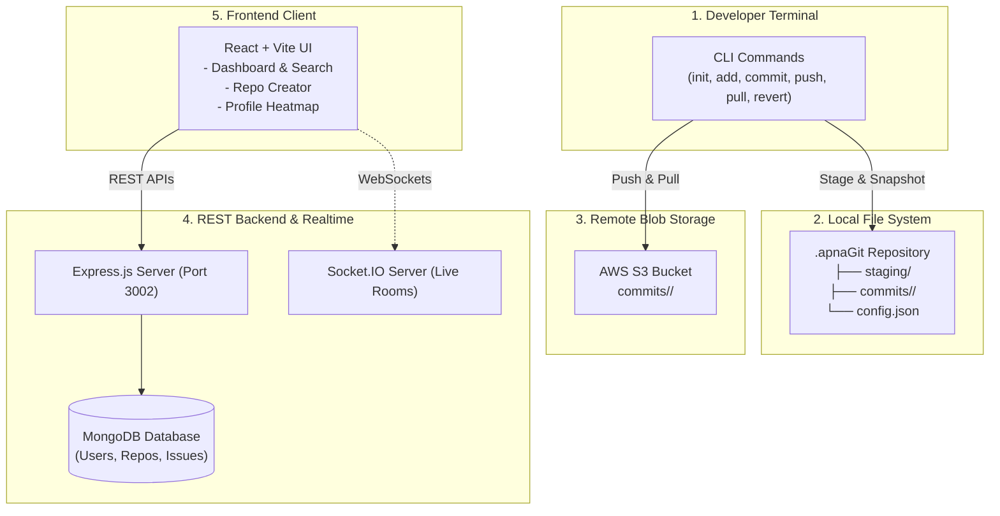

# ⚡ CodeVault — Distributed Version Control System & Web Platform

[](https://nodejs.org/)
[](https://expressjs.com/)
[](https://react.dev/)
[](https://vitejs.dev/)
[](https://www.mongodb.com/)
[](https://aws.amazon.com/s3/)
[](LICENSE)

> 🚀 **[Click here to view the Live Demo](https://alokkumar-design.github.io/CODEVAULT/)**

**CodeVault** is a full-stack, distributed version control system simulating both the **Git CLI engine** and the **GitHub web collaboration platform**. 

It features an internal snapshot engine in Node.js that tracks local file staging and commits inside a custom `.apnaGit` directory, streams remote backups to **AWS S3**, provides a **REST API** with MongoDB & JWT authentication, and renders a **React single-page application** with contribution activity heatmaps.

---

## 🏗️ System Architecture



---

## ✨ Features

### 💻 1. Custom Git CLI Engine
- **`init`**: Initializes a hidden `.apnaGit` directory with commit metadata tracking and cloud storage configurations.
- **`add <file>`**: Stages files by snapshotting them into `.apnaGit/staging/`.
- **`commit <message>`**: Generates an immutable UUID snapshot folder, copies staged files, and records commit metadata (`message`, `date`, `commitID`) in `commit.json`.
- **`push`**: Streams all local commit snapshots to an **Amazon Web Services (AWS S3)** bucket.
- **`pull`**: Synchronizes remote S3 commit objects back down to local storage.
- **`revert <commitID>`**: Rolls back the working directory to any historical snapshot state.

### 🌐 2. Web Application (GitHub Clone)
- **Authentication**: User sign up and login with salted password hashing (`bcrypt`) and signed `JWT` tokens.
- **Interactive Repository Management**: Create new repositories, toggle public/private visibility, search filter in real-time, and delete repositories.
- **Contribution Heatmap**: Visual activity calendar tracking user commits and project contributions.
- **Real-Time Collaboration**: Socket.IO integration for live updates and collaborative developer rooms.

---

## 📁 Repository Structure

```text
CODEVAULT/
├── backend-main/           # Express server & Git CLI engine
│   ├── config/             # AWS S3 and environment configurations
│   ├── controllers/        # CLI controllers (init, add, commit, push, revert) & Web controllers
│   ├── models/             # Mongoose schemas (User, Repository, Issue)
│   ├── routes/             # REST API routers (user, repo, issue)
│   ├── demo-server.js      # Zero-config standalone mock/demo server
│   └── index.js            # Main CLI & production server entry point
│
└── frontend-main/          # React + Vite web client
    ├── src/
    │   ├── components/     # UI components (Navbar, Dashboard, Profile, HeatMap, Auth)
    │   ├── authContext.jsx # Global user authentication state
    │   ├── Routes.jsx      # React Router route definitions
    │   └── App.jsx         # Root component
    └── package.json
```

---

## 🚀 Quickstart & Installation

### Prerequisites
- [Node.js](https://nodejs.org/) (v18+)
- [Git](https://git-scm.com/)

### 1. Clone the repository
```bash
git clone https://github.com/Alokkumar-design/CODEVAULT.git
cd CODEVAULT
```

### 2. Run the Web Backend
```bash
cd backend-main
npm install

# Start the server (runs on http://localhost:3002)
node demo-server.js
```

### 3. Run the Frontend Website
In a second terminal window:
```bash
cd frontend-main
npm install

# Start Vite dev server
npm run dev
```
Open **`http://localhost:5173`** in your browser.

---

## 🛠️ Testing the Custom Git CLI Locally

You can test the CLI engine directly in any project folder:

```bash
# 1. Create a sandbox folder
mkdir my-project
cd my-project

# 2. Initialise the repository
node <path-to-CODEVAULT>/backend-main/index.js init
# Output: Repository initialised!

# 3. Create a test file
echo "console.log('Hello CodeVault');" > index.js

# 4. Stage the file
node <path-to-CODEVAULT>/backend-main/index.js add index.js
# Output: File index.js added to the staging area!

# 5. Commit the change
node <path-to-CODEVAULT>/backend-main/index.js commit "Initial commit"
# Output: Commit <uuid> created with message: Initial commit

# 6. Revert to a past snapshot anytime
node <path-to-CODEVAULT>/backend-main/index.js revert <uuid>
# Output: Commit <uuid> reverted successfully!
```

---

## 📡 REST API Reference

| Method | Endpoint | Description |
| :--- | :--- | :--- |
| `POST` | `/signup` | Register a new user (returns JWT token & userId) |
| `POST` | `/login` | Authenticate user credentials and issue JWT token |
| `GET` | `/userProfile/:id` | Fetch user profile and associated repositories |
| `GET` | `/repo/all` | Retrieve all public repositories |
| `GET` | `/repo/user/:userId`| Get all repositories owned by a specific user |
| `POST` | `/repo/create` | Create a new repository |
| `DELETE`| `/repo/delete/:id` | Delete a repository by ID |
| `POST` | `/issue/create/:id`| Create an issue ticket on a repository |
| `GET` | `/issue/all/:id` | Retrieve all issues for a repository |

---

## 💡 Engineering Highlights (Interview Talking Points)

- **Snapshot-Based Versioning:** Rather than basic in-memory tracking, CodeVault interacts directly with OS disk I/O using Node.js `fs.promises` to manage a staging area and immutable commit records.
- **Remote Cloud Replication:** Demonstrates AWS S3 integration via streaming binary/text objects organized by hash prefixes.
- **Modular Controller Architecture:** Separates low-level terminal filesystem commands from higher-level HTTP API endpoints.
- **Robust Security:** Implements one-way salting with `bcrypt` (10 rounds) and stateless session verification using JSON Web Tokens (`jsonwebtoken`).

---

## 📄 License
This project is licensed under the ISC License - see the [LICENSE](LICENSE) file for details.
